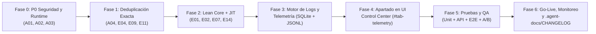
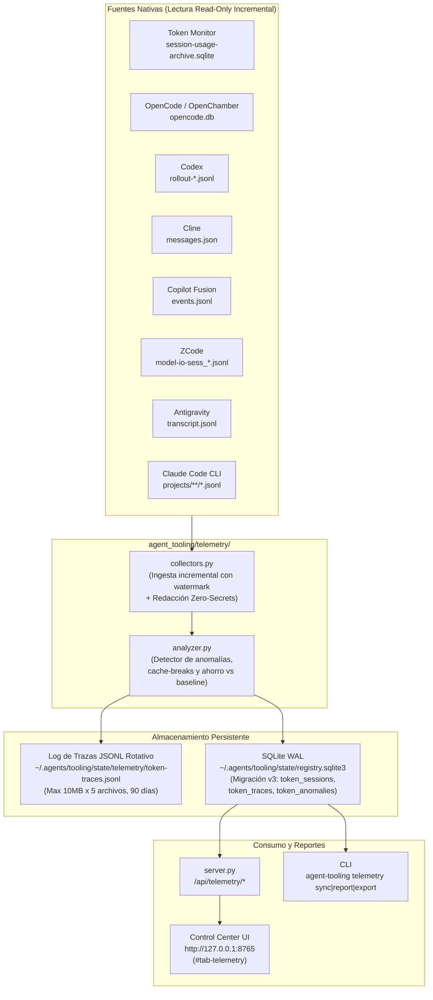

# Plan Maestro de Optimización de Tokens, Sistema de Telemetría/Trazas y QA Cross-Agent

> **Fecha:** 2026-11-21  
> **Base forense:** Auditoría Read-Only en [`audit-output/09-resumen-ejecutivo-y-decisiones-pendientes.md`](audit-output/09-resumen-ejecutivo-y-decisiones-pendientes.md) (29 artefactos verificados con SHA-256)  
> **Alcance:** `OpenCode V2 / OpenChamber`, `Codex`, `Cline`, `GitHub Copilot Fusion`, `Google Antigravity`, `ZCode`, `Claude Code CLI` y **`agent-tooling` Control Center (`http://127.0.0.1:8765`)**  
> **Estado:** Plan listo para aprobación y ejecución por fases (**cero cambios aplicados aún en producción**)

---

## 1. Objetivos y Metas Cuantitativas (Baseline vs Objetivo)

El objetivo de este plan es **reducir entre un 35% y un 62% el consumo de tokens de arranque** (y hasta un **85%** en sesiones largas) sin sacrificar calidad de respuesta ni capacidades especializadas (preservando el **Cold Vault** con 359+ skills accesibles *Just-in-Time*), al tiempo que dotamos al ecosistema de un **sistema propio de logs, trazas y reportes de consumo de tokens integrado en la interfaz del Control Center**, validado mediante un **plan formal de Pruebas y QA de 4 niveles**.

| Harness / Modo | Baseline `"HOLA"` (`[OBSERVADO]`) | Meta `"HOLA"` (`[OBJETIVO]`) | Ahorro Esperado | Causa Principal Atacada |
| :--- | ---: | ---: | :---: | :--- |
| **OpenChamber `Build`** | `39,514` in (2 calls) | **`≤ 15,000` in (1 call)** | **-62%** | Auto-invocación `using-superpowers` + triple `AGENTS.md` + `core` 37→6 skills |
| **OpenChamber `Plan`** | `39,845` in (2 calls) | **`≤ 14,500` in (1 call)** | **-64%** | Auto-invocación `using-superpowers` + triple `AGENTS.md` + `core` 37→6 skills |
| **OpenChamber `Ask`** | `18,294` in (1 call) | **`≤ 10,000` in (1 call)** | **-45%** | Triple `AGENTS.md` + `core` 37→6 skills |
| **Codex (`gpt-5.4`)** | `28,709` in (1 call) | **`≤ 19,500` in (1 call)** | **-32%** | 63 skills físicas duplicadas + plugins ociosos (198→6–26 skills) + doble hook `context-mode` |
| **ZCode (`glm-5-turbo`)** | `27,533` Call 1 / `35,416` Call 9 | **`≤ 20,700` Call 1** | **-25%** | Desactivar 4 plugins Office (`documents`, `pdf`, `presentations`, `spreadsheets`) en modo código |
| **Google Antigravity** | `18,830` in (1 call) | **`≤ 15,500` in (1 call)** | **-18%** | Eliminar doble `AGENTS.md` + doble `RTK.md` + `AGENTS.md Core-Compact` |
| **Cline (`gpt-6-luna`)** | `18,754` in (1 call) | **`≤ 15,200` in (1 call)** | **-19%** | Perfil `core-lean` (26→6 skills) + `AGENTS.md Core-Compact` |
| **Copilot Fusion** | `77,071` in (2 calls, `0.37 cr`) | **`≤ 36,000` in** (si suprime 2ª call) / **`≤ 68K`** | **-12% a -53%** | Perfil `core-lean` + prevención de *cache breaks* (`Call #13`: `0.68 cr`) |
| **Sesiones Largas (Outliers)** | `13,140,604` tok / `$3.79` | **`≤ 2,000,000` tok** (compactación a `80K`) | **-85%** | Regla + alerta automática en UI a `80K context` o `25 calls` |

### Criterio Innegociable de Calidad (Gate de Aceptación)
- **Score Global de Calidad:** **`S0 ≥ 4.70 / 5.00`** en el benchmark `T1–T5`.
- **Ninguna dimensión individual** (`S1` Exactitud técnica, `S2` Uso de tools, `S3` Cumplimiento de instrucciones, `S4` Completitud, `S5` Seguridad, `S6` Eficiencia de pasos, `S7` Activación JIT de skills) por debajo de **`4.50 / 5.00`**.
- **Cero secretos** en logs, SQLite, reportes o UI.

---

## 2. Arquitectura del Plan por Fases



---

## 3. Fase 0 — Seguridad, Gobernanza y Estabilización P0 (Prerrequisito)

**Regla:** Antes de cada modificación se genera un backup verificado con SHA-256 en `%LOCALAPPDATA%\agent-tooling-backups\<change-id>\`.

| Código | Acción Concreta | Archivo(s) Objetivo | Riesgo Mitigado | Verificación Inmediata |
| :---: | :--- | :--- | :--- | :--- |
| **`A01`** | Desactivar `opencode-prompt-logger@0.1.0` (`"enabled": false`) y archivar/purgar `prompts.ndjson` (`10.45 MB`) y `prompts.ndjson.1` (`16.73 MB`). | `C:\Users\edgar\.config\opencode\opencode.json` (línea 1327)<br>`C:\Users\edgar\AppData\Local\opencode\prompts.ndjson*` | `SEC-01`: Exposición de prompts crudos y crecimiento sin límite en disco (`27.18 MB`). | Confirmar que una nueva sesión en OpenChamber **no** escribe en `prompts.ndjson`. |
| **`A02`** | Reparar `SyntaxError: await isn't allowed in non-async function` en `oac-quota-guard` y migrar `openslimedit.ts` + `continuous-learning.ts` al formato de exportación V2 de OpenCode `2.3.2`. | `C:\Users\edgar\.config\opencode\plugins\oac-quota-guard.ts`<br>`openslimedit.ts`<br>`continuous-learning.ts` | `SEC-02` / `CR-06`: Freno de 3 reintentos/modelo y 6/sesión completamente inactivo. | Revisar `opencode.log`: cero `SyntaxError` y cero `PluginModule.LoadError` al iniciar OpenChamber. |
| **`A03`** | Sustituir API keys/tokens en texto plano por referencias de variables de entorno (`{env:VAR}`) y purgar los ~16 archivos `.bak-*` con secretos. | `C:\Users\edgar\.claude\config.json`<br>`C:\Users\edgar\.config\opencode\opencode.json`<br>`C:\Users\edgar\.codex\config.toml` | `SEC-03`: Credenciales en claro en disco y backups. | Ejecutar escáner `agent_tooling/security/redact.py` verificando 0 matches de secretos. |

---

## 4. Fase 1 — Deduplicación Exacta y Limpieza de Colisiones (Cero Riesgo Semántico)

| Código | Acción Concreta | Archivo(s) Objetivo | Ahorro Garantizado |
| :---: | :--- | :--- | :--- |
| **`A04-1`** | **Antigravity:** Eliminar la doble inyección de `AGENTS.md` (dejar workspace/global único, quitar copia redundante en `oac-custom-agents\rules\AGENTS.md`) y la doble regla `RTK` (`user_global` vs plugin `rtk\rules\AGENTS.md`). | `C:\Users\edgar\.gemini\config\plugins\oac-custom-agents\rules\AGENTS.md`<br>`C:\Users\edgar\.gemini\config\plugins\rtk\rules\AGENTS.md` | **`-1,265 tokens / llamada`** |
| **`A04-2`** | **OpenCode / OpenChamber:** Eliminar rutas duplicadas de `AGENTS.md` en el array `"instructions"` de `opencode.json` para que no se cargue 3 veces. | `C:\Users\edgar\.config\opencode\opencode.json` | **`-2,150 tokens / llamada`** |
| **`A04-3`** | **Codex (`E04` + `E09`):** Mover a backup las **63 carpetas físicas duplicadas** de `C:\Users\edgar\.codex\skills\` (dejando `~/.agents/skills` como única raíz gobernada), desactivar plugins ociosos en `~/.codex/config.toml` y eliminar el registro duplicado de `context-mode` en `~/.codex/hooks.json`. | `C:\Users\edgar\.codex\skills\`<br>`C:\Users\edgar\.codex\config.toml`<br>`C:\Users\edgar\.codex\hooks.json` | **`-4,300 a -5,000 tokens / llamada`** + fin de doble ejecución de hooks |

---

## 5. Fase 2 — Optimización Estructural: Arquitectura `Lean Core + JIT`

| Código | Acción Concreta | Archivo(s) Objetivo | Ahorro Estimado |
| :---: | :--- | :--- | :--- |
| **`E14`** | **Nuevo perfil `core-lean` (6 skills universales):** Crear `profiles/core-lean.yaml` y actualizar `CORE_ESSENTIAL_SKILLS` en `agent_tooling/profile_switcher.py` para exponer solo 6 skills universales (`find-skills`, `verification-before-completion`, `systematic-debugging`, `coding-standards`, `project-docs`, `project-changelog`). Las otras 353+ skills siguen disponibles *Just-in-Time* en `~/.agents/catalog/skills/` o vía `agent-tooling switch-profile <perfil>`. | `profiles/core-lean.yaml`<br>`agent_tooling/profile_switcher.py` | **`-2,300 tokens / llamada`** en todos los harnesses conectados a `~/.agents/skills` |
| **`E01`** | **Eliminar 2ª llamada automática en Turno 1 (`using-superpowers`):** Ajustar el frontmatter/descripción de `using-superpowers` para que **no** exija invocar la tool `skill()` ante saludos, preguntas conceptuales o prompts conversacionales (solo tareas de ingeniería multi-paso), o moverlo fuera de `core-lean`. | `C:\Users\edgar\.agents\catalog\skills\using-superpowers\SKILL.md` | **`-19,200 tokens`** (-50%) en cada Turno 1 de OpenChamber `Build`/`Plan` |
| **`E02`** | **Compilar `AGENTS.md` a versión `Core-Compact` (≤ 350 tokens):** Mantener el contrato normativo esencial en `AGENTS.md` y mover tablas detalladas/rutas largas a `.agent-docs/REFERENCE.md` (lectura bajo demanda). | `C:\Users\edgar\.agents\AGENTS.md`<br>`AGENTS.md` (workspace) | **`-750 a -850 tokens / llamada`** adicionales |
| **`E07`** | **ZCode (Perfil Código sin Suite Office):** Desactivar por defecto los 4 plugins Office (`documents`, `pdf`, `presentations`, `spreadsheets`) en ZCode cuando no se trabaja con ofimática (habilitables con 1 clic cuando se necesiten). | Configuración de plugins de ZCode (`~/.zcode/`) | **`-6,833 tokens / llamada`** (`-16 MCP tools`, `-20 skills`, `-6 subagentes visual-judge`) |
| **`E10`** | **Claude Code CLI (PMB Pull > Push):** Condicionar `pmb-PromptSubmit.ps1` en `~/.claude/settings.json` para que solo inyecte memorias cuando exista un proyecto activo o bajo invocación explícita (evitando `44K` cache writes en saludos). | `C:\Users\edgar\.claude\settings.json` | **`-$0.25 a -$0.35 USD`** por arranque de sesión en `claude.exe` |
| **`E15`** | **Higiene de Sesiones y Compactación:** Establecer regla operativa y alerta visual en UI al superar **`80,000 tokens` de contexto** o **`25 llamadas`** por sesión para disparar `/compact` o abrir sesión limpia. | `AGENTS.md` + `agent_tooling/telemetry/analyzer.py` | **-75% a -88%** en sesiones largas (evita outliers de `$3.79` / `13.1M tok`) |

---

## 6. Fase 3 — Diseño del Sistema Propio de Logs, Trazas y Métricas de Consumo de Tokens

Cumpliendo el **Contrato de Persistencia Único** (`SQLite` para estado observado e histórico + `JSONL` para log append-only rotativo + **Zero Secrets** + **Zero dependencias externas**):

### 6.1. Arquitectura de Datos (Doble Persistencia)



### 6.2. Log Estructurado de Trazas (`token-traces.jsonl`)
- **Ubicación:** `C:\Users\edgar\.agents\tooling\state\telemetry\token-traces.jsonl`
- **Rotación automática:** Al superar `10 MB` rota a `token-traces.1.jsonl` .. `token-traces.5.jsonl` (política de retención de 90 días).
- **Política Zero-Secrets (estricta):** **Nunca** almacena contenido de prompts, respuestas, código fuente ni tokens/keys. Solo registra metadatos cuantitativos y nombres de herramientas/skills.
- **Formato de cada línea JSONL:**
```json
{
  "schema_v": 1,
  "trace_id": "trc_20261121_122501_9f2a",
  "recorded_at": "2026-11-21T17:25:01Z",
  "harness": "openchamber",
  "mode": "build",
  "session_id": "ses_e01cd033bffeDerZjb8D12d6K0",
  "turn_index": 1,
  "call_index": 2,
  "model": "gpt-6-luna",
  "profile_active": "core-lean",
  "input_uncached": 14200,
  "cache_read": 0,
  "cache_write": 0,
  "output_tokens": 42,
  "reasoning_tokens": 0,
  "total_tokens": 14242,
  "cache_hit_ratio": 0.0,
  "cost_usd": 0.0,
  "ai_credits": 0.0,
  "latency_ms": 1840,
  "tools_called": ["read_file"],
  "skills_loaded_count": 6,
  "anomalies": []
}
```

### 6.3. Migración SQLite v3 (`agent_tooling/db/schema.py`)
Se añade la **Migración `(3, ...)`** idempotente a `registry.sqlite3` (`WAL`, `foreign_keys=ON`):

1. **`token_sessions`:** Resumen agregado por sesión (`session_id`, `harness`, `mode`, `title_sanitized`, `primary_model`, `profile_active`, `started_at`, `ended_at`, `calls_count`, `input_uncached`, `cache_read`, `cache_write`, `output_tokens`, `reasoning_tokens`, `total_tokens`, `cache_hit_ratio`, `cost_usd`, `ai_credits`, `anomaly_count`, `source_file`, `source_mtime`).
2. **`token_traces`:** Detalle por llamada individual (`trace_id`, `session_id` FK, `turn_index`, `call_index`, `timestamp`, `model`, `input_uncached`, `cache_read`, `cache_write`, `output_tokens`, `reasoning_tokens`, `total_tokens`, `cost_usd`, `ai_credits`, `latency_ms`, `tools_called_json`, `anomaly_flags_json`).
3. **`token_anomalies`:** Registro de incidentes detectados automáticamente (`anomaly_id`, `session_id` FK, `trace_id`, `rule_code`, `severity`, `detected_at`, `metric_value`, `threshold_value`, `recommendation`).
4. **`telemetry_watermarks`:** Cursor incremental (`source_key`, `last_mtime`, `last_offset_or_rowid`, `last_synced_at`) para que cada sincronización tome **`< 250 ms`** sin re-escanear archivos intactos.

### 6.4. Reglas Automáticas del Detector de Anomalías (`analyzer.py`)

| Código | Regla | Umbral | Severidad | Acción Sugerida en UI |
| :--- | :--- | :--- | :---: | :--- |
| **`DOUBLE_CALL_TURN1`** | ≥ 2 llamadas LLM en el Turno 1 con respuesta corta | `turn_index == 1 AND calls >= 2` | **ALTA** | Revisar auto-invocación (`using-superpowers` / `rename_session`). |
| **`CACHE_BREAK`** | Caída súbita de `cache_read` entre llamadas consecutivas | `cache_read < prev_cache_read * 0.5` (cuando `prev > 15K`) | **ALTA** | Revisar mutación del system prompt o expiración de TTL de caché. |
| **`CONTEXT_BLOAT`** | Contexto de una llamada excede umbral saludable | `input_total > 80,000` o `calls_count > 25` | **MEDIA** | Ejecutar `/compact` o iniciar sesión nueva. |
| **`OUTLIER_SESSION`** | Sesión supera consumo extremo acumulado | `session.total_tokens > 1,000,000` o `cost_usd > 1.00` | **CRÍTICA** | Auditar historial de sesión; evitar sesiones multi-día sin compactar. |
| **`TOOL_LOOP`** | Misma herramienta invocada repetidamente sin progreso | `≥ 4` llamadas consecutivas a la misma tool | **ALTA** | Verificar `oac-quota-guard` y límites de reintento. |

### 6.5. Nuevos Módulos y Comandos CLI
- `agent_tooling/telemetry/__init__.py`
- `agent_tooling/telemetry/collectors.py` (8 conectores read-only con degradación elegante si un harness no está instalado)
- `agent_tooling/telemetry/store.py` (escritura transaccional SQLite + rotación segura de `token-traces.jsonl`)
- `agent_tooling/telemetry/analyzer.py` (reglas de anomalías + cálculo de ahorro vs baseline de auditoría)
- `agent_tooling/telemetry/exporter.py` (exportador a `Markdown`, `CSV` y `JSON`)
- **CLI en `agent_tooling/__main__.py`:**
  - `agent-tooling telemetry sync` — Ingesta incremental de todos los harnesses.
  - `agent-tooling telemetry report --range 7d --format md` — Reporte resumido en consola o archivo.
  - `agent-tooling telemetry export --out reportes/tokens.csv` — Exportación estructurada.
  - `agent-tooling telemetry prune --days 90` — Limpieza de trazas antiguas según retención.

---

## 7. Fase 4 — Nuevo Apartado en la Interfaz del Control Center (`http://127.0.0.1:8765`)

Se integrará directamente en la interfaz existente (`agent_tooling/ui/index.html` y `agent_tooling/ui/server.py`) manteniendo el diseño **zero-external-dependencies** (HTML/CSS/JS nativo + gráficos SVG ligeros, coherente con `#tab-tokens` y `#tab-logs`).

### 7.1. Endpoints REST en `agent_tooling/ui/server.py`

| Método | Ruta | Descripción |
| :---: | :--- | :--- |
| `GET` | `/api/telemetry/summary?range=24h\|7d\|30d\|all&harness=all` | KPIs globales, series diarias, desglose por harness/modelo y comparativa vs baseline. |
| `GET` | `/api/telemetry/sessions?harness=all&model=all&anomalies_only=0&limit=50` | Listado paginado de sesiones con métricas de tokens, cache hit % y badges de anomalía. |
| `GET` | `/api/telemetry/traces?session_id=<id>` | Trazas paso a paso (llamada por llamada) de una sesión para el panel *drill-down*. |
| `GET` | `/api/telemetry/anomalies?severity=all&limit=50` | Feed de alertas activas (`CACHE_BREAK`, `DOUBLE_CALL_TURN1`, `CONTEXT_BLOAT`, etc.). |
| `POST` | `/api/telemetry/sync` | Dispara sincronización incremental en vivo y devuelve conteo de nuevas trazas ingeridas. |
| `GET` | `/api/telemetry/export?format=md\|csv\|json&range=7d` | Descarga directa del reporte de consumo con cabecera `Content-Disposition: attachment`. |

### 7.2. Diseño del Nuevo Tab `#tab-telemetry` ("Telemetría & Trazas")

Se agrega el botón de navegación **`Telemetría & Trazas`** en la barra lateral del Control Center (junto a `Ahorro de Tokens` y `Logs del Sistema`) con **6 bloques visuales**:

1. **Barra de Control Superior:** Selector de rango (`24h`, `7 días`, `30 días`, `Todo`), filtro de Harness (`Todos`, `OpenChamber`, `Codex`, `Cline`, `Copilot`, `Antigravity`, `ZCode`, `Claude Code`), botón **`Sincronizar Ahora`** (con indicador de última sincronización) y menú **`Exportar Reporte (MD / CSV / JSON)`**.
2. **Fila de 5 Tarjetas KPI:**
   - **Tokens Totales** (desglosados en Uncached / Cache Read / Output)
   - **Costo Estimado** (`$ USD` + `AI Credits`)
   - **Cache Hit Ratio Global (%)** (con semáforo: verde `≥ 80%`, ámbar `50–79%`, rojo `< 50%`)
   - **Ahorro vs Baseline Auditoría (%)** (comparando el promedio actual con el baseline del 21-nov)
   - **Anomalías Detectadas** (contador clicable que filtra incidentes críticos/altos)
3. **Gráficos Nativos (SVG):**
   - **Tendencia de Consumo por Día** (barras apiladas: `Uncached Input` vs `Cache Read` vs `Output`).
   - **Comparativa Cross-Harness** (tokens promedio por llamada y costo por harness).
4. **Panel "Antes vs Después (Optimizaciones A/B)":** Tabla viva que compara el baseline forense (`audit-output/canonical-sessions.csv`) contra el consumo actual tras activar `core-lean` y las optimizaciones de cada fase.
5. **Tabla de Sesiones + Inspector Drill-Down de Trazas:** Al hacer clic en cualquier sesión se despliega la línea de tiempo llamada por llamada (`Call #1`, `Call #2`, ...), mostrando `modelo`, `input_uncached`, `cache_read`, `output`, `tools_called`, `latencia` y las banderas de anomalía (por ejemplo, resaltando en rojo un `CACHE_BREAK` o `DOUBLE_CALL_TURN1`).
6. **Visor Rápido del Log `token-traces.jsonl`:** Últimas 50 entradas JSONL con búsqueda instantánea y botón `Abrir carpeta de logs en Explorer`.

---

## 8. Fase 5 — Plan Integral de Pruebas y QA (4 Niveles)

Ninguna fase se dará por terminada sin superar los **4 niveles de QA** y sus criterios de aceptación:

### Nivel 1 — Pruebas Unitarias Automatizadas (`pytest`)
Nuevas suites en `tests/` que se suman a `test_v3_core.py` y `test_ecc_and_ui.py`:

| Archivo de Test | Casos de Prueba Clave | Criterio de Éxito |
| :--- | :--- | :--- |
| `tests/test_telemetry_schema.py` | Migración v1→v2→v3 idempotente; integridad `PRAGMA foreign_keys=ON` y `WAL`; rollback seguro ante fallo parcial. | 100% pass; `integrity_check == "ok"`. |
| `tests/test_telemetry_collectors.py` | Parsing con fixtures sintéticos de los 8 harnesses (SQLite, JSONL, JSON); ingesta incremental con `watermark` (no duplica filas en doble `sync`); manejo de archivos corruptos/ausentes. | 100% pass; 0 duplicados tras 2 syncs seguidos. |
| `tests/test_telemetry_analyzer.py` | Detección exacta de `DOUBLE_CALL_TURN1`, `CACHE_BREAK`, `CONTEXT_BLOAT`, `OUTLIER_SESSION` y `TOOL_LOOP` con casos reales anonimizados del informe (ej. Call #13 de Copilot, sesión `13.14M` de Antigravity). | 100% precisión en los 5 detectores. |
| `tests/test_telemetry_security.py` | Verifica que `token-traces.jsonl` y SQLite **jamás** persistan prompts crudos, API keys (`sk-`, `ghp_`, `AIza`), ni rutas con credenciales; prueba rotación de archivo al superar `10 MB`. | 0 fugas detectadas por `redact.py`. |
| `tests/test_profile_core_lean.py` | Verifica que `switch-profile core-lean` deja exactamente 6 junctions en `~/.agents/skills` y mantiene íntegras las 359+ skills en el Cold Vault (`~/.agents/catalog/skills`). | 100% pass; rollback restaura perfil previo. |

### Nivel 2 — Pruebas de Integración y API (`tests/test_telemetry_api.py`)
- Levanta `ThreadingHTTPServer` en un puerto efímero sobre una base de datos temporal con fixtures reales.
- Valida todos los endpoints `/api/telemetry/summary`, `/sessions`, `/traces`, `/anomalies`, `/sync` y `/export?format=md|csv|json`.
- Verifica códigos HTTP (`200`, `400`, `404`), estructura JSON, cabeceras `Content-Type` / `Content-Disposition` y tiempos de respuesta (`< 300 ms`).

### Nivel 3 — QA Funcional y Visual de Interfaz E2E (`agent-browser` / `Playwright`)
Se ejecuta contra `http://127.0.0.1:8765` en una instancia local:
1. Navegar al tab **`Telemetría & Trazas` (`#tab-telemetry`)** y verificar renderizado completo sin errores en consola JS (`0 console.error`, `0 failed network requests`).
2. Validar que las 5 tarjetas KPI y los gráficos SVG renderizan valores coherentes con `/api/telemetry/summary`.
3. Probar filtros combinados (`rango=7d` + `harness=openchamber` + `solo anomalías`) y verificar actualización reactiva de la tabla.
4. Hacer clic en una sesión y confirmar que el **Inspector Drill-Down** muestra las trazas individuales y badges de anomalía.
5. Pulsar **`Sincronizar Ahora`** y **`Exportar Reporte (MD / CSV)`** comprobando descarga válida y estado de carga.
6. Capturar screenshots de evidencia visual (desktop `1440x900` y viewport compacto `1024x768`) para validar legibilidad y ausencia de desbordamientos.

### Nivel 4 — Validación A/B de Optimizaciones y No-Regresión de Calidad (`E01–E15`)
Siguiendo [`audit-output/benchmark-spec.yaml`](audit-output/benchmark-spec.yaml) y [`audit-output/evaluation-rubric.md`](audit-output/evaluation-rubric.md):
- **Matriz de 5 tareas reales (`T1`–`T5`):**
  - `T1`: Saludo trivial `"HOLA"` (verifica eliminación de 2ª llamada y costo mínimo de arranque).
  - `T2`: Lectura y resumen técnico de archivo del repo (verifica comprensión sin pérdida).
  - `T3`: Bugfix multi-archivo + ejecución de `pytest` (verifica `systematic-debugging` + `verification-before-completion`).
  - `T4`: Activación **Just-in-Time (JIT)** de una skill del Cold Vault no presente en `core-lean` (verifica que el recorte a 6 skills **no** pierde capacidades especializadas).
  - `T5`: Sesión multi-turno (verifica estabilidad del *prompt cache* y ausencia de *cache breaks*).
- **Presupuesto acotado:** Lote Prioritario Top-5 (`~$0.35 USD`) o Suite Completa (`≤ $1.50 USD` / `≤ 1.50 AI credits`).
- **Regla de Rollback Automático:** Si cualquier optimización reduce `S0 < 4.70` o alguna dimensión `< 4.50`, se revierte inmediatamente usando el backup SHA-256 de `%LOCALAPPDATA%\agent-tooling-backups\<change-id>\`.

---

## 9. Fase 6 — Operación Continua y Definition of Done (DoD)

El proyecto se considerará **100% completado** cuando se cumplan todos los puntos:

- [ ] **Seguridad P0 cerrada:** `opencode-prompt-logger` apagado (`prompts.ndjson*` purgado), `oac-quota-guard` V2 operativo sin errores en `opencode.log`, y 0 credenciales en texto plano.
- [ ] **Optimizaciones verificadas:** Reducción medida en telemetría real ≥ 35% en arranque y eliminación de la 2ª llamada en Turno 1 de OpenChamber.
- [ ] **Sistema de Telemetría operativo:** `token-traces.jsonl` escribiendo y rotando correctamente + Migración SQLite v3 en `registry.sqlite3` + sincronización incremental `< 250 ms`.
- [ ] **Apartado UI en Control Center:** Tab `#tab-telemetry` visible y funcional en `http://127.0.0.1:8765` con KPIs, gráficas, drill-down de trazas y exportación de reportes (`MD / CSV / JSON`).
- [ ] **QA aprobado al 100%:** `pytest` completo en verde (unit + API), QA E2E de UI sin errores de consola, y benchmark A/B con `S0 ≥ 4.70 / 5.00`.
- [ ] **Documentación sincronizada:** `.agent-docs/`, `.agent-docs/CHANGELOG.md` y `AGENTS.md` actualizados y listos para commit.

---

## 10. Autorización para Iniciar la Ejecución

Indícame con cuál bloque deseas comenzar (puedes aprobar todo en secuencia o por bloque):

1. **Bloque 1 — Seguridad y Limpieza P0 (`Fase 0` + `Fase 1`: `A01–A04`)** — Cero riesgo funcional, elimina 27 MB de logs de prompts, repara `oac-quota-guard` y limpia duplicados exactos.
2. **Bloque 2 — Sistema de Logs de Telemetría + Apartado UI + Suite de Pruebas (`Fase 3` + `Fase 4` + `QA Niveles 1–3`)** — Implementa `token-traces.jsonl`, SQLite v3, recolectores cross-harness, el nuevo tab `#tab-telemetry` en `http://127.0.0.1:8765` y toda la batería de tests + QA E2E.
3. **Bloque 3 — Optimización `Lean Core + JIT` + Benchmark A/B (`Fase 2` + `QA Nivel 4`)** — Activa `core-lean`, corrige `using-superpowers`, optimiza ZCode/Claude/AGENTS.md y mide el *Antes vs Después* directamente en la nueva interfaz de Telemetría.
