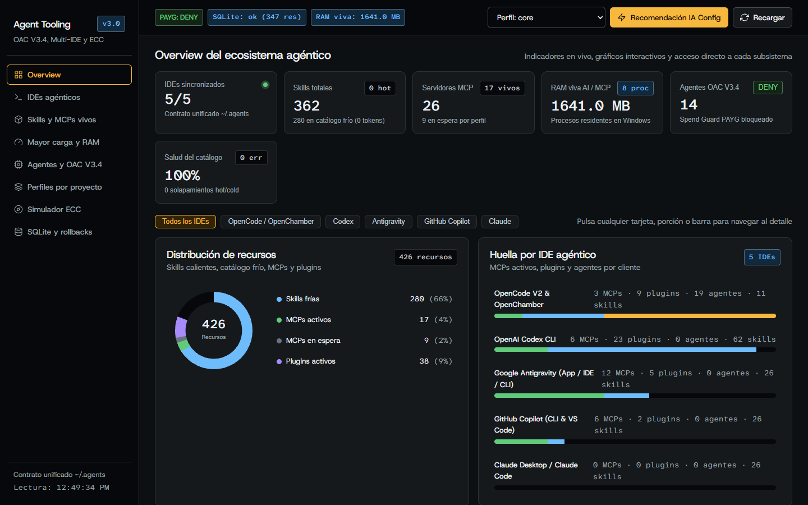
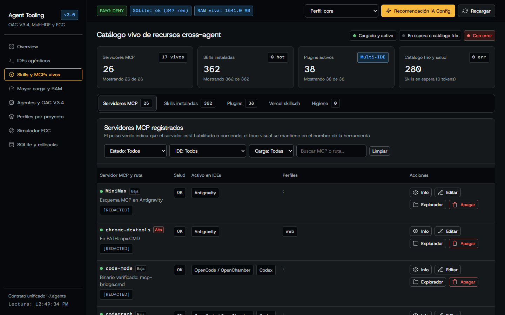
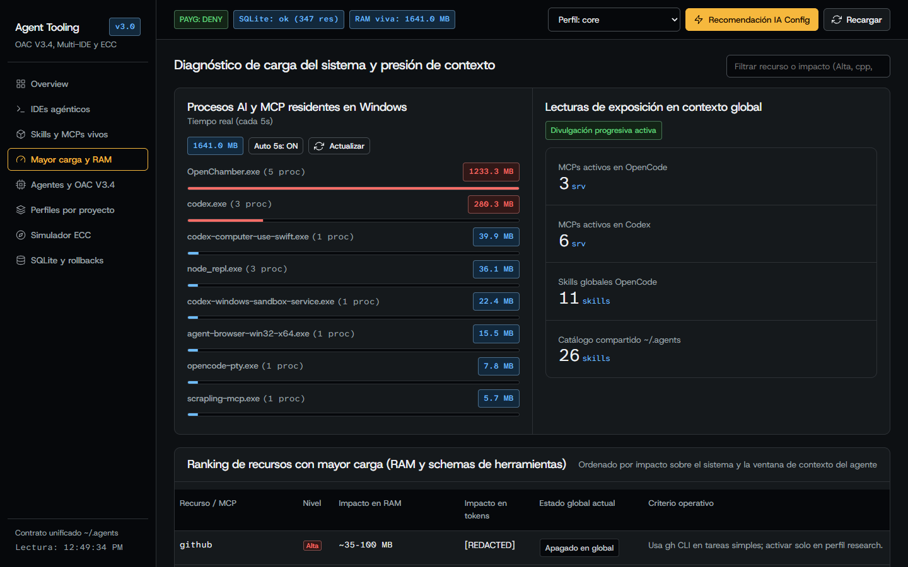
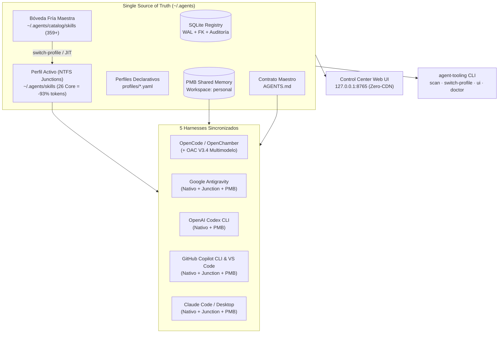

<a id="readme-top"></a>

<div align="center">

# Agent Tooling v3 — Multi-IDE Agentic Framework

**Un único plano de control para orquestar Skills, Servidores MCP, Memoria Persistente, Perfiles Declarativos y Ahorro Radical de Tokens en OpenCode/OpenChamber, Codex, Google Antigravity, GitHub Copilot y Claude.**

[](https://github.com/matrixelfe/multi-agents-profiles-mcp-skills/releases)
[](#el-motor-de-ahorro-de-tokens-93)
[](#matriz-de-harnesses-soportados)
[](#memoria-persistente-y-aprendizaje-continuo)
[](#gobernanza-oac-v34)
[](docs/ECOSYSTEM-PLAYBOOK.md)

[Por qué este Framework](#por-qué-este-framework) · [Capturas en Vivo](#control-center-en-vivo) · [Ahorro de Tokens (93%)](#el-motor-de-ahorro-de-tokens-93) · [Memoria & Evolución](#memoria-persistente-y-aprendizaje-continuo) · [Inicio Rápido](#inicio-rápido) · [Playbook](docs/ECOSYSTEM-PLAYBOOK.md)

</div>

---

## Por qué este Framework

Cuando trabajas todos los días con múltiples agentes e IDEs (**OpenCode / OpenChamber, Codex CLI, Google Antigravity, GitHub Copilot y Claude**), el ecosistema colapsa rápido por cuatro problemas reales:

1. **Explosión de tokens de contexto:** tener 350+ skills globales inyecta más de **44,000 tokens** de metadatos en cada sesión, provocando recortes silenciosos (*177 skills excluidas*) y respuestas más lentas y caras.
2. **Memoria fragmentada:** lo que aprendes en Antigravity se pierde al abrir Codex, OpenChamber o Copilot.
3. **Configuración duplicada:** cada IDE tiene su propio formato (`opencode.json`, `config.toml`, `mcp_config.json`, `mcp-config.json`, `mcp.json`) y gestionar MCPs/skills a mano genera caos.
4. **Ceguera operativa:** no sabes qué MCPs están vivos, cuánta RAM consumen en Windows ni si un cambio rompió tu configuración.

**Agent Tooling v3** convierte ese caos en un **framework evolutivo unificado** con **una sola fuente de verdad**, **memoria compartida**, **perfilamiento instantáneo** y un **Control Center Web local (`http://127.0.0.1:8765`)**.

---

## Control Center en Vivo

### 1. Overview Dashboard Interactivo
Métricas en vivo, filtro global por IDE, Donut SVG interactivo de recursos, huella por cliente, presión de contexto MCP y distribución de tipos de skills más usados.



### 2. Gestión Unificada de Skills, MCPs y Plugins
Contadores en vivo, sub-pestañas (*MCPs*, *Skills*, *Plugins*, *Vercel `skills.sh`*, *Higiene*), filtros desplegables rápidos (Estado, IDE, Carga, Categoría), pulso verde animado para recursos activos y modal **Info / Editar / Explorador / Archivar** con rutas exactas en disco.



### 3. Monitor de RAM en Tiempo Real (5s) y Presión de Contexto
Telemetría directa de procesos AI/MCP residentes en Windows con actualización automática cada 5 segundos, botón manual **Actualizar** y ranking de servidores por impacto en RAM y tokens.



---

## Arquitectura del Framework



---

## El Motor de Ahorro de Tokens (93%)

En lugar de cargar 359 skills en cada conversación, el framework utiliza un **NTFS Junction Farm reversible** con **cero borrados**:

| Métrica | Antes (`Perfil: Todas`) | Ahora (`Perfil: core` + Superpowers) | Impacto |
|---|---|---|---|
| **Skills cargadas en sesión** | `343 – 359` | **`26`** *(14 Superpowers + Core)* | **-93% volumen** |
| **Tokens de metadatos (Antigravity)** | `44,656 / 20,000` (223% rojo) | **`~3,800 / 20,000`** (< 20% verde) | **0 skills excluidas** |
| **Skills especializadas disponibles** | Recortadas al azar | **359 intactas en Bóveda Fría (JIT)** | **0 tokens en reposo** |

- **Cambio en 1 clic:** selecciona `core`, `web`, `gamedev`, `browser-automation`, `android`, `windows-native`, `reverse`, `research` o `all` desde la barra superior del Control Center y **los 5 IDEs cambian en < 1 segundo**.
- **Activación Just-in-Time (JIT):** si estás en `core` y surge una tarea de GameDev, Expo o Reverse Engineering, cualquier agente puede leer la skill directo desde `~/.agents/catalog/skills/<skill>/SKILL.md` sin precargarla globalmente.
- **Automatización web eficiente (`browser-automation`):** prioriza `agent-browser` (Vercel Labs CLI + Skill con `snapshot -i`) antes de escalar a `chrome-devtools`, Playwright o `computer-use`.

---

## Memoria Persistente y Aprendizaje Continuo

El ecosistema **aprende y evoluciona con el tiempo** sin importar qué IDE abras hoy:

- **Memoria Cross-IDE (`pmb-shared`):** los 5 harnesses (OpenCode, Codex, Antigravity, GitHub Copilot CLI/VS Code y Claude) comparten exactamente el mismo motor de memoria persistente local (`pmb.exe mcp proxy --no-fallback` sobre un único daemon en `127.0.0.1:8765`, workspace `personal`). Decisiones, lecciones aprendidas y hechos clave viajan contigo entre herramientas ahorrando ~1 GiB de RAM por cliente.
- **Suite completa Superpowers (14 skills activas en `core`):** `brainstorming`, `writing-plans`, `executing-plans`, `systematic-debugging`, `test-driven-development`, `verification-before-completion`, `subagent-driven-development`, `dispatching-parallel-agents`, `using-git-worktrees`, `requesting-code-review`, `receiving-code-review`, `finishing-a-development-branch`, `using-superpowers` y `writing-skills`.
- **Documentación viva automática:** `project-docs` y `project-changelog` mantienen `.agent-docs/`, `CHANGELOG.md` y `AGENTS.md` actualizados en cada iteración.
- **Actualización fácil desde repos oficiales:** [manifests/skills-top.yaml](manifests/skills-top.yaml) guarda los repos upstream oficiales y [scripts/install-skills.ps1](scripts/install-skills.ps1) permite actualizar tu stack en un comando.

---

## Matriz de Harnesses Soportados

| Harness | Skills Compartidas | Memoria PMB | Agentes & Modelos | Control Center UI |
|---|---|---|---|---|
| **OpenCode / OpenChamber** | `~/.agents/skills` | `pmb-shared` | **OAC V3.4 Multimodelo + Spend Guard** | Editable + Rollback SHA-256 |
| **Google Antigravity** | Junction `~/.gemini/config/skills` | `pmb-shared` | **Nativos** (+ `AGENTS.md` unificado) | Monitorización + Perfil activo |
| **OpenAI Codex CLI** | `~/.agents/skills` | `pmb-shared` | **Nativos** | Editable + Rollback SHA-256 |
| **GitHub Copilot (CLI & VS Code)** | Junction `~/.copilot/skills` | `pmb-shared` | **Nativos** | Monitorización + Filtros + Perfil |
| **Claude Code / Desktop** | Junction `~/.claude/skills` | `pmb-shared` | **Nativos** | Monitorización + Perfil activo |

---

## Gobernanza OAC V3.4

- **Aislamiento limpio:** el enrutamiento multimodelo (`config/oac-routing.yaml`) y los 19 agentes OAC corren **exclusivamente en OpenCode / OpenChamber**, manteniendo a Antigravity, Codex, Copilot y Claude 100% limpios y nativos.
- **Spend Guard (`PAYG = DENY`):** bloquea fallbacks a proveedores facturables por uso.
- **Seguridad y Reversibilidad:** cada edición crea backup privado con verificación **SHA-256** en `%LOCALAPPDATA%\agent-tooling-backups\`. **0 secretos** en Git o SQLite.

---

## Inicio Rápido

### Opción A — Instálalo con tu Agente AI (Recomendado)
Simplemente dile a **Antigravity, OpenCode/OpenChamber, Codex, GitHub Copilot o Claude**:
> *"Oye agente, instálame este repo: `https://github.com/matrixelfe/multi-agents-profiles-mcp-skills`"*

El agente leerá automáticamente [INSTALL-WITH-AGENT.md](INSTALL-WITH-AGENT.md) y [manifests/skills-catalog-by-profile.md](manifests/skills-catalog-by-profile.md) y ejecutará el flujo guiado:
1. Instala el motor `agent-tooling`, las NTFS Junctions y el buscador oficial **Vercel `find-skills`**.
2. **Te pregunta interactivamente qué paquetes de skills quieres agregar** (puedes elegir uno, varios o todos): *Core & Superpowers*, *Fullstack & UI*, *GameDev & 3D*, *Ingeniería & Seguridad*, *Mobile/Expo* o *Reverse Engineering*.
3. Descarga cada paquete con **Vercel `skills`**, lo consolida en tu **Bóveda Fría** (`0` tokens en reposo), **inspecciona y auto-repara** frontmatter YAML / hooks / scripts, y deja activo el perfil `core` (**93% de ahorro en tokens**).

> También puedes buscar, instalar y auto-reparar cualquier skill nueva con 1 clic desde el **Control Center Web** → *Skills y MCPs vivos → Vercel `skills.sh`*.

### Opción B — Instalación Manual
#### 1. Clonar e instalar el framework
```powershell
git clone https://github.com/matrixelfe/multi-agents-profiles-mcp-skills.git
cd multi-agents-profiles-mcp-skills
pip install -e .
```

### 2. Instalar skills curadas y enlazar IDEs (Windows)
```powershell
# Instala/actualiza el Top de skills desde sus repos oficiales
powershell -ExecutionPolicy Bypass -File scripts\install-skills.ps1

# Crea NTFS Junctions para Antigravity, Copilot y Claude -> ~/.agents/skills
powershell -ExecutionPolicy Bypass -File scripts\setup-junctions.ps1

# Propaga ~/.agents/AGENTS.md a los 5 harnesses sin pisar reglas nativas (bloque BEGIN/END + backup SHA-256)
agent-tooling sync-instructions
```

### 3. Lanzar el Control Center Web
```powershell
agent-tooling ui
```
Abre `http://127.0.0.1:8765` para gestionar perfiles, RAM en vivo, MCPs, skills, higiene y rollbacks.

---

## Documentación y Guías

- **[ECOSYSTEM-PLAYBOOK.md](docs/ECOSYSTEM-PLAYBOOK.md):** Guía completa de arquitectura, tips, hacks de Windows/PowerShell 5.1, ahorro de tokens y lecciones aprendidas para replicar este framework.
- **[templates/mcp-cross-agent.json](templates/mcp-cross-agent.json):** Plantilla limpia (sin secretos) para conectar `pmb-shared`, `codegraph` y `chrome-devtools` en todos tus IDEs.
- **[manifests/skills-top.yaml](manifests/skills-top.yaml):** Manifiesto curado de skills con sus repositorios oficiales para actualización continua.

---

## Verificación y Calidad

- **Tests automatizados:** `python -m pytest -v` (`14/14 passed`: migraciones SQLite, backups SHA-256, redacción de secretos, reglas ECC, Spend Guard y cambio de perfiles con NTFS Junctions).
- **Auditoría UI Hallmark:** `sloplint.mjs` (`0 FAIL, 0 REFLEX, 0 WARN`).

---

<div align="right">

[Volver arriba](#readme-top)

</div>
