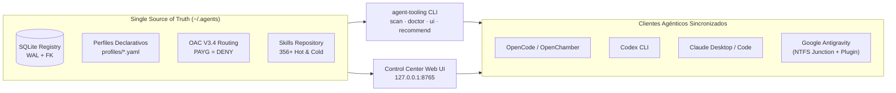

<a id="readme-top"></a>

<div align="center">

# Agent Tooling v3 — Multi-IDE Control Center

**Orquestación unificada de Skills, Servidores MCP, Plugins, Perfiles Declarativos y Gobernanza OAC V3.4 para OpenCode, OpenChamber, Codex, Claude y Google Antigravity.**

[](https://github.com/matrixelfe/multi-agents-profiles-mcp-skills/releases/tag/v3.1.0)
[](https://www.python.org/)
[](#arquitectura)
[](#gobernanza-oac-v34)
[](#clientes-soportados)

[Explorar Características](#características-principales) · [Control Center UI](#control-center-web-ui-v31) · [Inicio Rápido](#inicio-rápido) · [Perfiles](#perfiles-declarativos) · [Comandos CLI](#referencia-cli)

</div>

---

## Acerca del proyecto

Los ecosistemas agénticos modernos suelen fragmentarse entre múltiples IDEs y CLIs (**OpenCode / OpenChamber**, **Codex**, **Claude Desktop / Code** y **Google Antigravity**), provocando duplicación de skills, sobrecarga de la ventana de contexto por MCPs pesados, falta de visibilidad sobre la RAM consumida y riesgos de facturación accidental (PAYG).

**Agent Tooling v3** resuelve esto con un **Contrato Único de Persistencia** y un **Control Center Web interactivo (`http://127.0.0.1:8765`)** diseñado bajo estética *Hallmark Console (graphite)*:

- **Una sola fuente de verdad:** `SQLite` (estado observado e historial) + `YAML` (estado deseado en perfiles y enrutamiento OAC) + `~/.agents/skills` (repositorio central de más de **350 skills** compartido vía NTFS Junction).
- **Cero desperdicio de contexto:** separación automática entre **catálogo caliente** y **catálogo frío** (0 tokens en sesiones generales) + divulgación progresiva.
- **Seguridad y reversibilidad total:** cada edición o archivado genera un **backup privado con verificación SHA-256** y comando de rollback instantáneo. **Cero secretos** en Git o SQLite.

---

## Arquitectura



---

## Características principales

### Control Center Web UI (v3.1)
Lanza `agent-tooling ui` para abrir la consola local en `http://127.0.0.1:8765` (100% local, sin dependencias CDN externas):

| Apartado | Capacidades clave |
|---|---|
| **Overview (Dashboard Interactivo)** | 6 tarjetas KPI clicables, filtro global por IDE, **Donut SVG interactivo** de recursos, huella por IDE, presión de contexto MCP + RAM viva, perfiles OAC y gráfico **Tipos de Skills más usados** agrupable por *Categoría*, *Perfil* o *IDE*. |
| **IDEs Agénticos** | Vista por cliente con modo **Editar**, alternancia de MCPs, **Guardar** (backup SHA-256), **Restaurar por defecto** y sincronización directa de Antigravity. |
| **Skills y MCPs vivos** | Sub-pestañas para **MCPs**, **Skills**, **Plugins**, **Vercel `skills.sh`** e **Higiene y duplicados**, con **filtros desplegables** (Estado, IDE, Carga, Categoría), pulso verde animado para recursos activos, rutas en disco y modal **Info / Editar / Explorador / Archivar**. |
| **Mayor carga y RAM** | Lectura en vivo de procesos AI/MCP residentes en Windows (`MB`) y ranking de servidores por impacto en RAM y tokens. |
| **Agentes y OAC V3.4** | Matriz de 19 agentes, niveles de privacidad (`zero_retention` vs. `retention_30d`) y bloqueo estricto **Spend Guard (`PAYG = DENY`)**. |
| **Simulador ECC & Perfiles** | Recomendador contextual de skills/MCPs por tarea y perfil sin contaminar el contexto global. |
| **SQLite y Rollbacks** | Verificación `PRAGMA integrity_check`, auditoría de cambios y restauración por `change_id`. |

---

## Clientes soportados

| Cliente | Sincronización | Skills Compartidas | MCPs & Plugins |
|---|---|---|---|
| **OpenCode / OpenChamber** | Nativa (`opencode.jsonc`) | `~/.agents/skills` | Editable desde UI + Plugins DCP/Supermemory |
| **Codex** | Nativa (`.codex/config.toml`) | `~/.agents/skills` | Editable desde UI + Plugins Codex |
| **Google Antigravity** | NTFS Junction + `oac-custom-agents` | `~/.gemini/config/skills → ~/.agents/skills` | 4 agentes primarios + 15 subagentes + `AGENTS.md` unificado |
| **Claude Desktop / Code** | Observación y perfiles | `~/.agents/skills` | Detección de estado y políticas |

---

## Perfiles declarativos

Los perfiles en `profiles/*.yaml` activan solo las herramientas necesarias por tipo de proyecto:

| Perfil | Enfoque principal | Herramientas destacadas |
|---|---|---|
| `core` | Base ligera para cualquier repo | `computer-use`, `context-engineering`, `project-docs` |
| `web` | Frontend, Next.js, React, E2E | `chrome-devtools`, `agent-browser`, `hallmark`, `ui-ux-pro-max` |
| `browser-automation` | Automatización web ahorrando tokens | `agent-browser` (CLI + Skill), escalamiento a DevTools/Playwright |
| `gamedev` | Motores 3D, shaders, recompilación | `game-player`, catálogo frío `gamedev-*` (28 skills) |
| `windows-native` | C/C++, Rust, drivers, Win32 | `cpp`, `modern-cpp`, `rust-review`, `kernel-*` |
| `android` | Gradle, AOSP, Expo, ADB | `android-build`, `expo-native-ui`, `expo-router` |
| `reverse` | Ingeniería inversa y seguridad | `rea`, `craft-anything`, `reverse-engineering`, `security-review` |
| `research` | Investigación profunda y evaluación | `advanced-evaluation`, `context-optimization` |
| `experimental` | Sandbox de nuevas integraciones | Pruebas aisladas con rollback |

---

## Inicio rápido

### Requisitos
- **Windows 10/11** (PowerShell 5.1+) o Linux/macOS
- **Python 3.11+** y **Node.js 20+** (opcional para `agent-browser` / `npx skills`)

### Instalación
```powershell
git clone https://github.com/matrixelfe/multi-agents-profiles-mcp-skills.git
cd multi-agents-profiles-mcp-skills
pip install -e .
```

### Lanzar el Control Center
```powershell
agent-tooling ui
```
Abre automáticamente `http://127.0.0.1:8765` con el Dashboard **Overview** interactivo.

---

## Referencia CLI

```powershell
# Escanear IDEs, MCPs, skills y plugins hacia SQLite
agent-tooling scan

# Ver estado general del ecosistema y salud de SQLite
agent-tooling status
agent-tooling doctor

# Obtener recomendación contextual ECC para una tarea
agent-tooling recommend --agent openagent --task "auditar seguridad de API" --profile web

# Sincronizar agentes, reglas y junction de skills en Antigravity
agent-tooling sync-antigravity-agents

# Lanzar la consola web local
agent-tooling ui
```

---

## Notas de Instalación Cross-Harness (Skills, Plugins, Hooks & MCPs)

Consulta la guía detallada con comandos de instalación, registro de hooks por IDE, verificación y repositorios upstream en:

- **[docs/INSTALLATION-NOTES.md](docs/INSTALLATION-NOTES.md)** — cubre `PMB`, `RTK`, `OpenSlimedit`, `Headroom`, `UTCP Code-Mode`, `Continuous Learning v2` y `TokenEconomizer`.
- **[manifests/skills-top.yaml](manifests/skills-top.yaml)** — manifiesto declarativo con URLs upstream y comandos de instalación.
- **[templates/mcp-cross-agent.json](templates/mcp-cross-agent.json)** — plantilla limpia (cero secretos) de servidores MCP compartidos.

---

## Gobernanza OAC V3.4

- **`config/oac-routing.yaml`** es la única autoridad para enrutamiento de modelos y fallbacks.
- **Spend Guard (`PAYG = DENY`)** bloquea asignaciones de modelos de pago por uso no autorizados.
- **Pruebas automatizadas:** `python -m pytest -v` (13/13 tests pasando: migraciones SQLite idempotentes, integridad de backups, redacción de secretos, reglas ECC y bloqueo Spend Guard).

---

<div align="right">

[Volver arriba](#readme-top)

</div>
